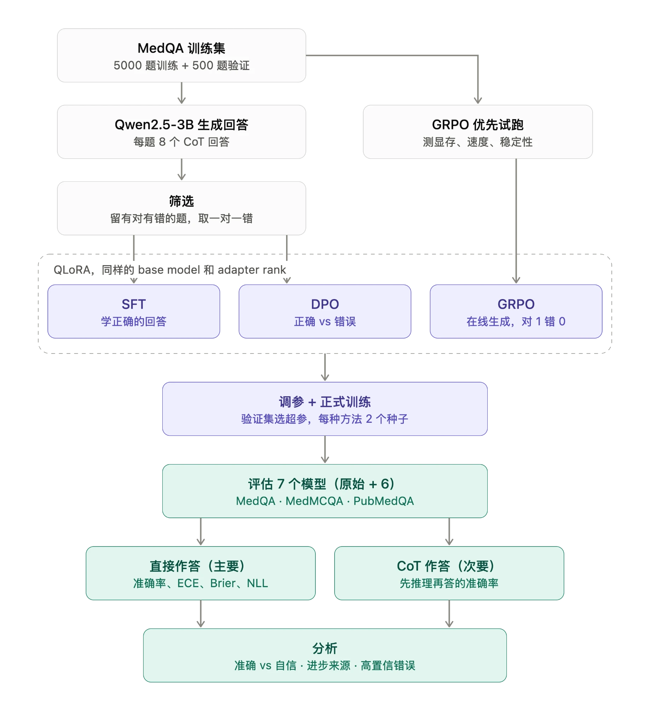

# calibration（作业仓库中的评估部分）

比较 SFT / DPO / GRPO（QLoRA）对 Qwen2.5-3B-Instruct 在医学选择题上**校准**的影响。本仓库是评估部分。

## 整体流程


## 文件
| 文件 | 作用 |
|---|---|
| `eval/data_loaders.py` | 加载 MedQA / MedMCQA / PubMedQA，统一成 (题目, 选项, 标准答案字母, id) |
| `eval/evaluate.py` | 4-bit 加载模型（可叠加 LoRA），用选项字母的 logits 计算概率，输出每题明细 CSV |
| `eval/metrics.py` | 只读明细 CSV，计算准确率 / ECE / Brier / NLL / 高置信错误等，画可靠性图 |
| `eval/test_metrics.py` | 手算小例子验证指标公式 |
| `notebooks/eval_base.ipynb` | Colab 一键运行评估 |
| `train/grpo/grpo.py` | GRPO 试跑主程序（QLoRA + TRL `GRPOTrainer`），记录耗时 / 显存 / reward 等指标 |
| `train/grpo/grpo_data.py` | 加载 MedQA **train** split，构造训练 prompt |
| `train/grpo/rewards.py` | 提取 `Answer: X` 并打 0/1 分；监控格式正确率、组内 reward 全相同比例等 |
| `train/grpo/test_rewards.py` | 打分函数单元测试 |
| `train/grpo/estimate.py` | （试跑专用）用试跑实测耗时估算正式训练的 GPU 小时 |
| `notebooks/grpo_pilot.ipynb` | Colab 一键运行 GRPO 试跑 |

## 常用命令（先 `cd calibration`，在这个文件夹里运行）
```bash
python -m pytest eval/test_metrics.py -q                      # 验证指标
python -m eval.data_loaders --dataset medqa --n 3             # 只看数据样例
python -m eval.evaluate --dataset medqa medmcqa pubmedqa \
    --adapter /path/to/adapter --model_name sft_seed1 --out_dir results/
python -m eval.metrics --pred_csv "results/preds_*.csv" --out_dir results/metrics

python -m pytest -q train/grpo/test_rewards.py                # 验证打分函数
python -m train.grpo.grpo --n_questions 64 --max_steps 30 --output_dir outputs/grpo_pilot   # GRPO 试跑（需要 GPU）
```

## 明细 CSV 字段
`dataset, question_id, model_name, eval_mode, n_options, gold, pred, confidence, correct, letter_mass, n_prompt_tokens, prob_A … prob_E`
- `prob_*`：在选项字母上归一化后的概率（该题不存在的选项为空）
- `letter_mass`：归一化**前**所有选项字母（含 "A" 与 " A" 两种写法）在整个词表上的概率之和，越接近 1 越说明 prompt 有效
- 每个 CSV 旁边有 `_meta.json`，记录 prompt 版本、量化设置、库版本等，用来确认 7 个模型的设置完全一致
