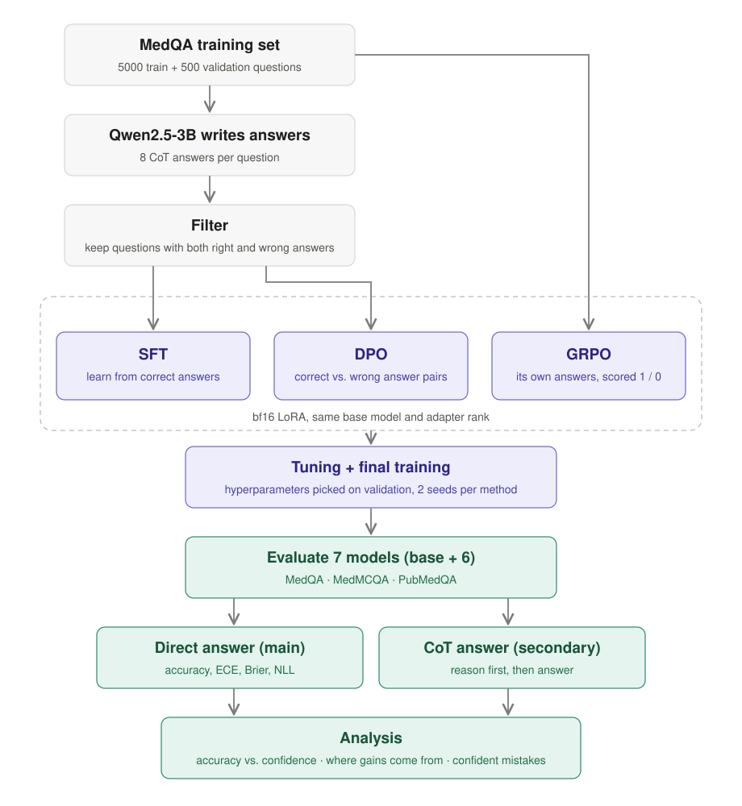

# Calibration of post-trained LLMs on medical QA

We fine-tune Qwen2.5-3B-Instruct on MedQA with three post-training methods (SFT, DPO and GRPO) and look at how each one changes **calibration**: does the model's confidence match how often it's actually right? Everything is tested on MedQA, and we also check transfer to MedMCQA and PubMedQA.



## What's where

| Folder | What's in it |
|---|---|
| `data/` | the fixed MedQA split shared by all methods (5000 training + 500 validation questions) |
| `eval/` | shared eval code: dataset loading, direct-answer and CoT scoring, calibration metrics, temperature scaling |
| `train/` | training code for DPO (`train/dpo/`) and GRPO (`train/grpo/`) |
| `notebooks/` | Colab notebooks that run each step, one folder per method: `base/`, `sft/`, `dpo/`, `grpo/` |
| `results_summary/` | results, one folder per model: `base/`, `sft/`, `dpo/`, `grpo/`, each with its own README |
| `outputs/` | the generated answers that SFT and DPO train on, plus raw DPO run outputs |
| `docs/` | the pipeline figure |

## The three methods

| Method | What it learns from | Code | Results |
|---|---|---|---|
| SFT | correct answers written by the base model | `notebooks/sft/` | `results_summary/sft/` |
| DPO | pairs of a correct and a wrong answer to the same question | `train/dpo/`, `notebooks/dpo/` | `results_summary/dpo/` |
| GRPO | answers it writes itself during training, scored 1 if right and 0 if wrong | `train/grpo/`, `notebooks/grpo/` | `results_summary/grpo/` |

The untrained model's results are in `results_summary/base/`.

## Shared setup

- Base model: Qwen2.5-3B-Instruct, trained with LoRA (r 16, alpha 32, dropout 0.05).
- Training data: the 5000 training questions in `data/medqa_split_seed42.json`. The 500 validation questions are only used for tuning and are never trained on.
- Eval data: MedQA test (1273 questions), MedMCQA validation (4183) and the expert-labeled PubMedQA set (1000).
- Metrics: accuracy, ECE (15 bins), Brier score, NLL, and how often the model is wrong with confidence >= 0.9 (`eval/metrics.py`).

## Running things

Run these from the repo root.

```bash
pip install -r requirements.txt

python -m pytest -q data eval/test_metrics.py eval/test_cot_eval.py train/grpo   # unit tests, no GPU needed

python -m eval.data_loaders --dataset medqa --n 3                                 # look at a few questions
python -m eval.evaluate --dataset medqa medmcqa pubmedqa \
    --adapter /path/to/adapter --model_name my_model --out_dir results/           # direct-answer eval
python -m eval.cot_eval --adapter /path/to/adapter --model_name my_model \
    --out_dir results/                                                            # reason-then-answer eval (needs vLLM)
python -m eval.metrics --pred_csv "results/preds_*.csv" --out_dir results/metrics # metrics + reliability diagrams
```

Each eval writes one CSV row per question (`dataset, question_id, model_name, eval_mode, gold, pred, confidence, correct, prob_A ...`) plus a `_meta.json` with the prompt version, precision and library versions, so runs can be checked for matching setups.
