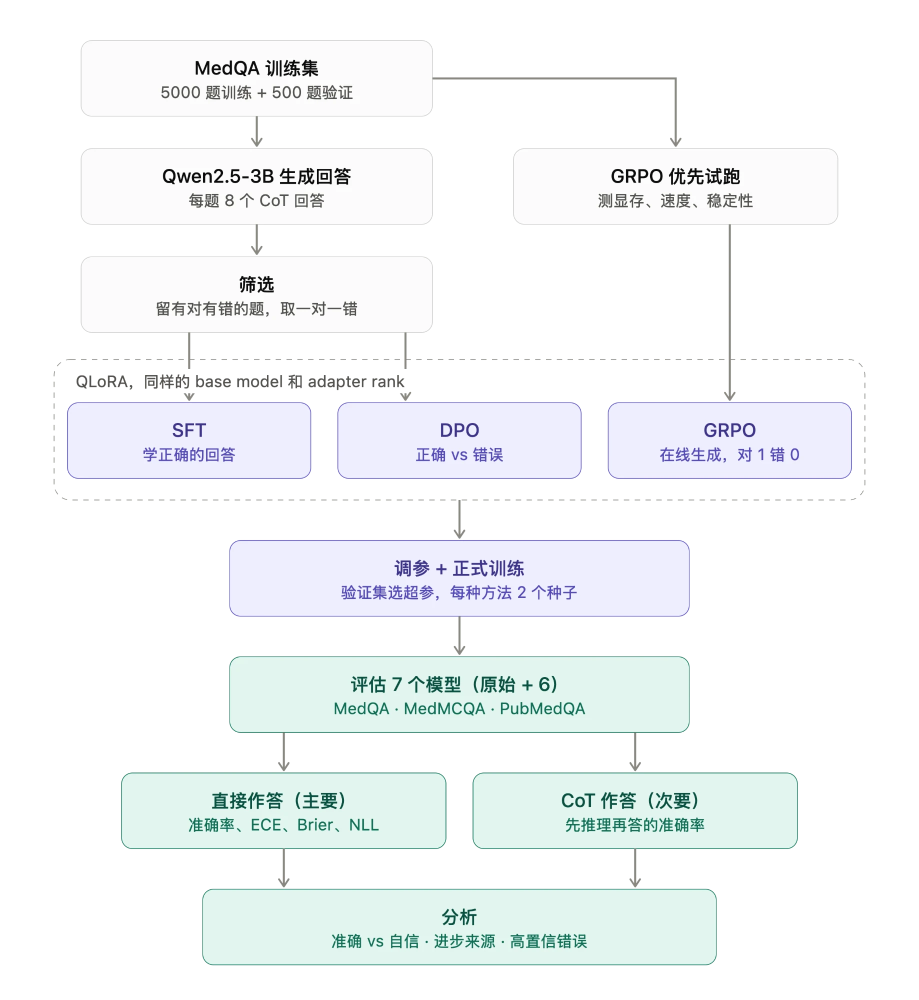

# calibration (the eval part of the project repo)

Comparing how SFT / DPO / GRPO (QLoRA) affect the **calibration** of Qwen2.5-3B-Instruct on medical multiple-choice questions. This repo is the eval part.

## Overall pipeline


## Files
| File | What it does |
|---|---|
| `data/medqa_split.py` + `data/medqa_split_seed42.json` | fixed split of the MedQA train split: 5000 training + 500 validation questions (shared by SFT / DPO / GRPO) |
| `eval/data_loaders.py` | loads MedQA / MedMCQA / PubMedQA into one format (question, options, gold letter, id) |
| `eval/evaluate.py` | loads the model in 4-bit (`--quantization none` for unquantized bf16; LoRA optional), gets probabilities from the option-letter logits, writes a per-question CSV |
| `eval/cot_eval.py` | evaluates with the reasoning prompt from GRPO training (vLLM generation, letter probability after `Answer:` + sampled voting), writes the same CSV format |
| `eval/metrics.py` | reads only the per-question CSVs, computes accuracy / ECE / Brier / NLL / confident-but-wrong etc., draws reliability diagrams |
| `eval/test_metrics.py` | checks the metric formulas against small hand-worked examples |
| `notebooks/eval_base.ipynb` | runs the eval on Colab in one go |
| `train/grpo/grpo.py` | GRPO training script (TRL `GRPOTrainer`), logs time / memory / reward etc. |
| `train/grpo/grpo_data.py` | loads the MedQA **train** split and builds the training prompts |
| `train/grpo/rewards.py` | pulls out `Answer: X` and scores it 0/1; tracks format rate, share of groups where every reward is the same, etc. |
| `train/grpo/test_rewards.py` | unit tests for the reward function |
| `train/grpo/estimate.py` | (pilot only) estimates GPU hours for the full run from the pilot's measured time per step |
| `notebooks/grpo_pilot.ipynb` | runs the GRPO pilot on Colab in one go |
| `notebooks/grpo_train.ipynb` | runs full GRPO training on Colab (bf16 LoRA + vLLM, checkpoints on Drive, can resume after a disconnect) |
| `notebooks/grpo_val_compare.ipynb` | compares base and GRPO on the 500 validation questions on Colab (direct answer + reason then answer) |

## Common commands (`cd calibration` first and run them from that folder)
```bash
python -m pytest eval/test_metrics.py -q                      # check the metrics
python -m pytest -q data/test_medqa_split.py                  # check the 5000/500 split
python -m eval.data_loaders --dataset medqa --n 3             # just look at data samples
python -m eval.evaluate --dataset medqa medmcqa pubmedqa \
    --adapter /path/to/adapter --model_name sft_seed1 --out_dir results/
python -m eval.evaluate --dataset medqa --medqa_subset val \
    --adapter /path/to/adapter --model_name sft_seed1 --out_dir results/   # evaluate on the 500 validation questions
python -m eval.cot_eval --adapter /path/to/adapter --model_name grpo_seed1 --out_dir results/   # reason then answer (GRPO prompt, needs vLLM)
python -m eval.metrics --pred_csv "results/preds_*.csv" --out_dir results/metrics

python -m pytest -q train/grpo/test_rewards.py                # check the reward function
python -m train.grpo.grpo --n_questions 64 --max_steps 30 --output_dir outputs/grpo_pilot   # GRPO pilot (needs a GPU)
```

## Per-question CSV columns
`dataset, question_id, model_name, eval_mode, n_options, gold, pred, confidence, correct, letter_mass, n_prompt_tokens, prob_A … prob_E`
- `prob_*`: probabilities normalized over the option letters (empty for options the question doesn't have)
- `letter_mass`: total probability of all the option letters (both "A" and " A" spellings) over the whole vocab **before** normalizing; the closer to 1, the better the prompt is working
- each CSV has a `_meta.json` next to it with the prompt version, quantization settings, library versions etc., to confirm all 7 models were run with exactly the same setup
